<div align="center">


# 🌿 Kush Acres 🌿

**A pixel-art isometric weed farming game for Android and Linux.**
Plant it, water it, watch it grow under a real sky, and turn a dirt patch behind a shack into the dankest empire in the county.

[](https://github.com/M4S4T0-V01D/kush-acres/releases/latest)
[](LICENSE)
[](https://github.com/M4S4T0-V01D/kush-acres/releases)


### [🌐 Website](https://m4s4t0-v01d.github.io/kush-acres/) · [📱 Download APK](https://github.com/M4S4T0-V01D/kush-acres/releases/latest/download/KushAcres.apk) · [🐧 Download for Linux](https://github.com/M4S4T0-V01D/kush-acres/releases/latest/download/KushAcres-linux.tar.gz)

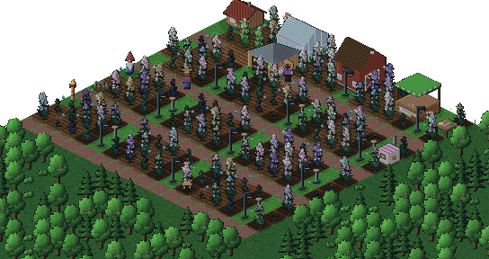

<sub>Real-time day and night: 24 hours in 6 seconds.</sub>

</div>

## 🔥 What's growing

| | |
|---|---|
| 🌱 **250 strains** | Every plant grows in real time with its own look. Water it, beat the pests and mould, and harvest it ripe and frosty. |
| 🧬 **Breeding & phenos** | Cross strains in the lab, pop seed packs hunting for an elite keeper, then keep her as a mother and clone her. |
| 🏆 **The Cup** | Enter your best bud against rivals like Skunk Patel and The Reverend for cash, Pot Bucks and bragging rights. |
| 🗺️ **30 farms** | Redwood Hollow, Volcano Isle, Neon Valley, Fort 20, Zion Gardens, the Haunted Manor and more, each with its own map and town. |
| 🌧️ **Weather & seasons** | Sun, fog, rain and storms roll through, the seasons turn, and lamps and fireflies light up the night. |
| 💨 **Sesh** | Roll joints, blunts and hotboxes from your own stash for buffs. Some trips get very trippy. |
| 👨‍🌾 **Crew** | Runners, fetchers, farmhands, cooks, a lookout and a manager keep things running while you're away. |
| 🏚️ **Build it out** | Grow rooms, drying sheds, trim rooms, rollers, presses, a kitchen, power, a deep bunker and a lawn full of decor. |
| 🎉 **Holidays** | Real-calendar events like Halloween, Christmas, St Patrick's, Easter and 4/20, each with its own farm, tokens and pets. |
| 📸 **And more** | Photo mode, 4-way rotation, contracts, vehicles, pets, legacy prestige, 80 levels, and updates from inside the game. |

## 🎬 In motion

<table>
<tr>
<td>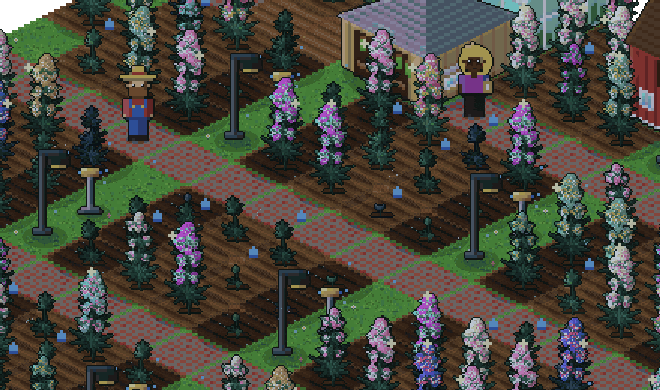</td>
<td>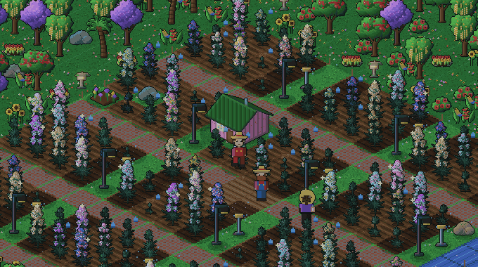</td>
</tr>
<tr>
<td align="center"><sub>Seedling to frosty (sped way up)</sub></td>
<td align="center"><sub>Zion Gardens</sub></td>
</tr>
</table>

<p align="center">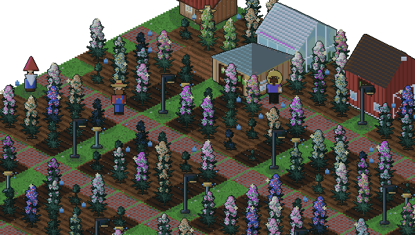</p>

## 🖼️ Screenshots

<table>
<tr>
<td>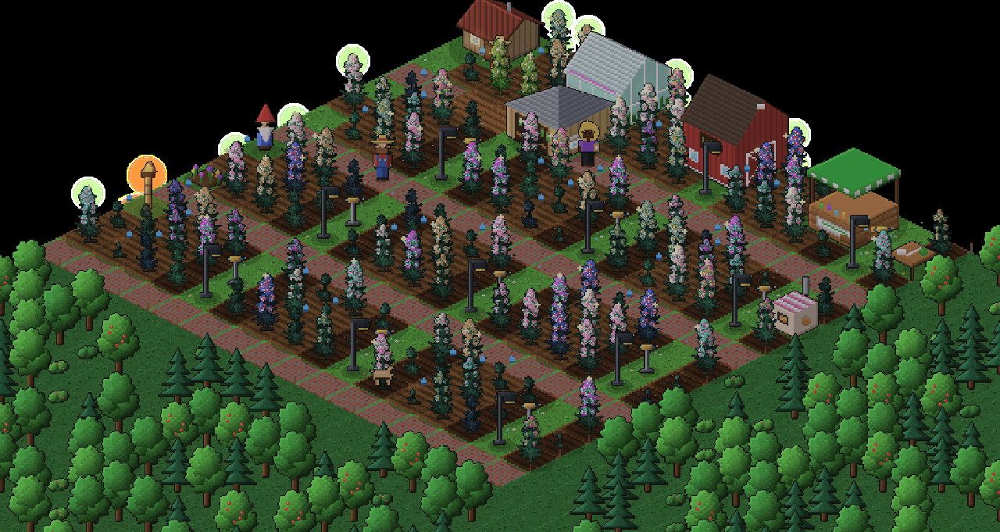</td>
<td>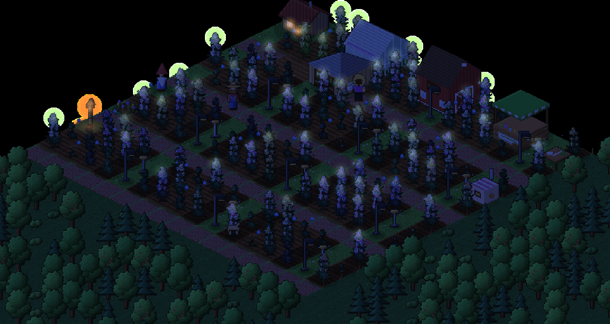</td>
</tr>
<tr>
<td>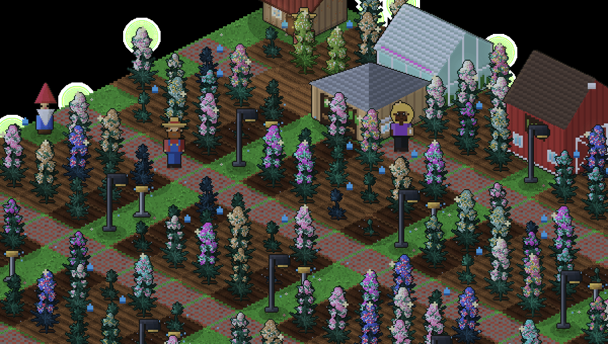</td>
<td>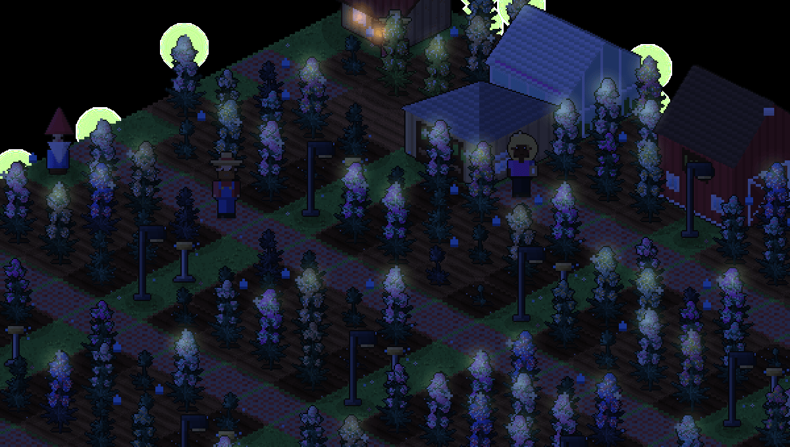</td>
</tr>
</table>

### Pick your turf

<table>
<tr>
<td>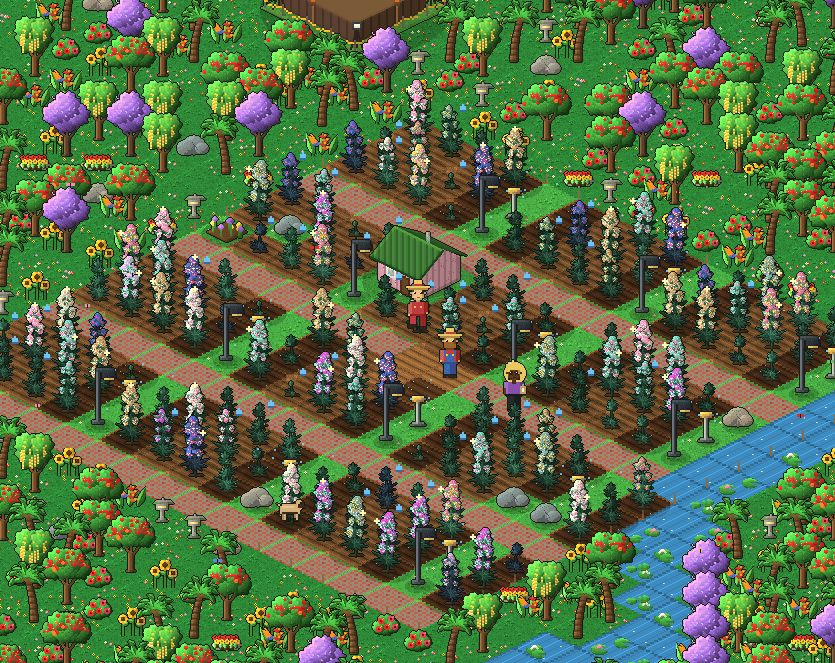<br><sub>Zion Gardens</sub></td>
<td>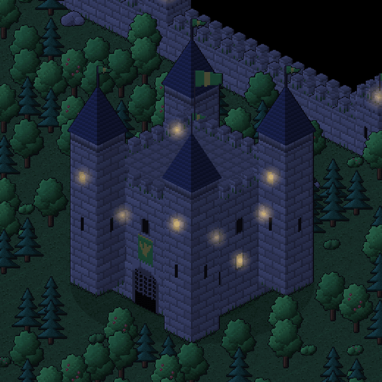<br><sub>Fort 20</sub></td>
<td>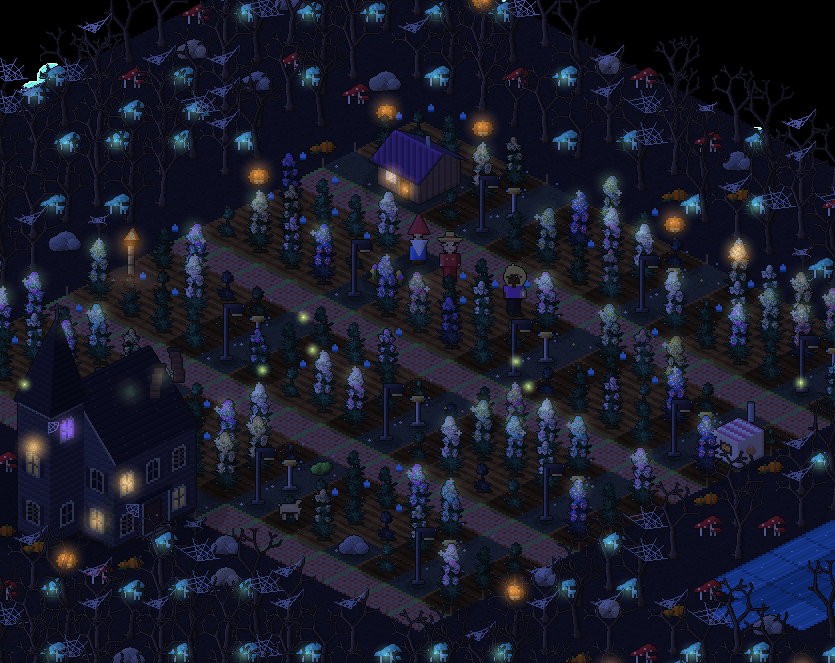<br><sub>Haunted Manor</sub></td>
</tr>
<tr>
<td>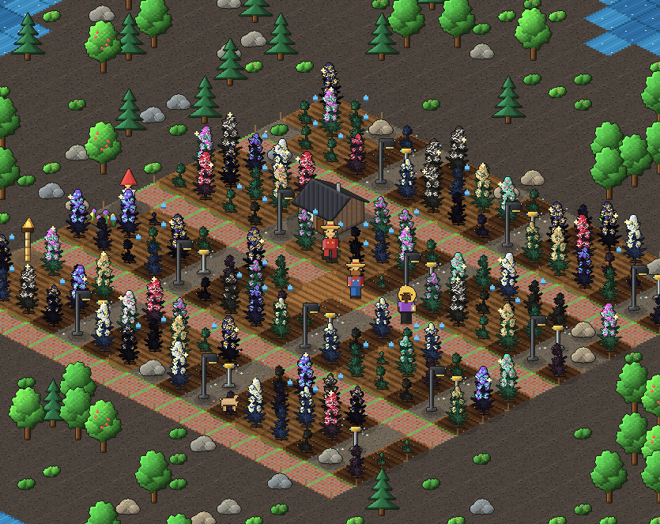<br><sub>Volcano Isle</sub></td>
<td>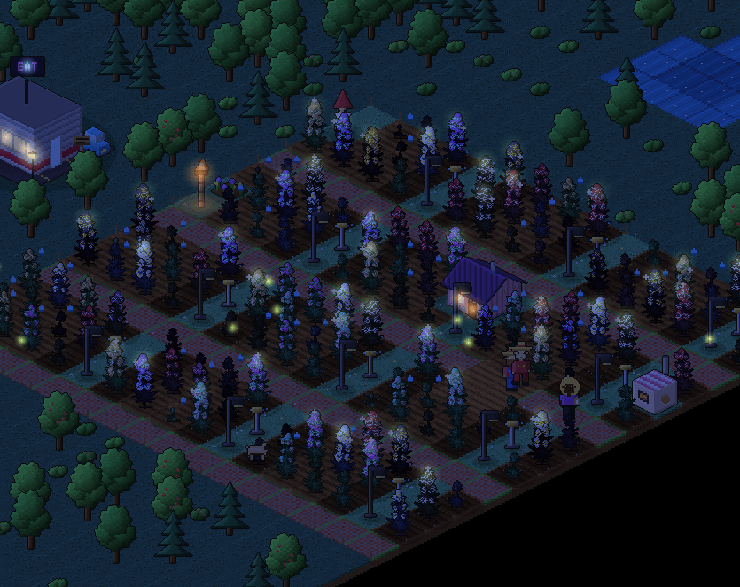<br><sub>Neon Valley</sub></td>
<td>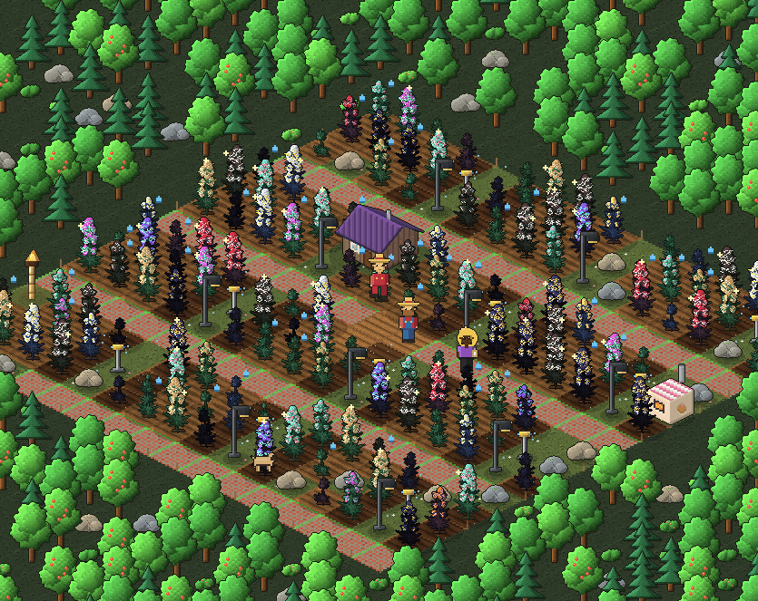<br><sub>Spooky Hollow</sub></td>
</tr>
</table>

### The Farm Book

<p align="center">
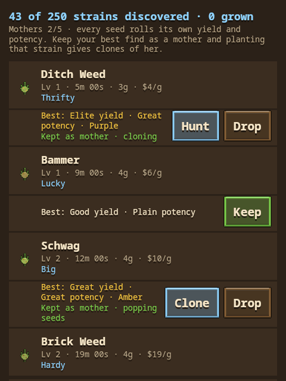
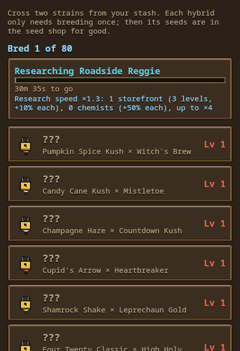
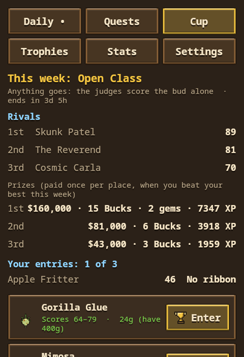
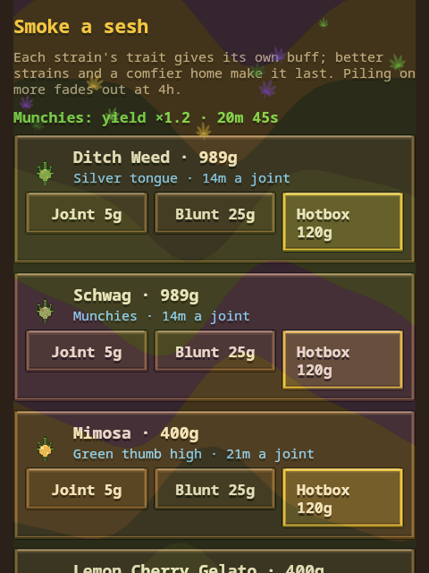
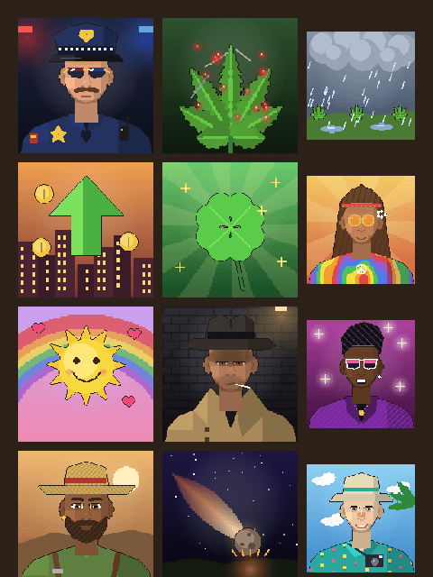
</p>

## ⬇️ Install

### 📱 Android

1. Download [`KushAcres.apk`](https://github.com/M4S4T0-V01D/kush-acres/releases/latest/download/KushAcres.apk) from the latest release.
2. Open it, and allow installs from your browser if Android asks.
3. That's it. The game checks GitHub for new releases and updates itself in a tap.

### 🐧 Linux

```sh
curl -LO https://github.com/M4S4T0-V01D/kush-acres/releases/latest/download/KushAcres-linux.tar.gz
tar xzf KushAcres-linux.tar.gz
./KushAcres/bin/KushAcres
```

It ships with its own Java runtime, so there's nothing else to install.

| Key | Does |
|---|---|
| <kbd>W</kbd><kbd>A</kbd><kbd>S</kbd><kbd>D</kbd> / arrows | Pan |
| <kbd>+</kbd> <kbd>−</kbd> | Zoom |
| <kbd>Q</kbd> <kbd>E</kbd> | Rotate |
| <kbd>F11</kbd> | Fullscreen |
| <kbd>Esc</kbd> | Back |

## 🛠️ Build

```sh
./build.sh                      # signed release APK -> KushAcres.apk
./build.sh testDebugUnitTest    # unit tests
./build.sh :desktop:run         # run the desktop build
```

To release, bump `version.properties` and run `./release.sh "notes"`. Releases must be signed with the same key so installed copies keep updating.

The screenshots and GIFs in `docs/media` are rendered by the game itself:

```sh
XDG_DATA_HOME=$(mktemp -d) KUSH_SHOWCASE=/tmp/kush-showcase ./build.sh :desktop:run
```

The roadmap lives in [PLAN.md](PLAN.md). The website is in [`docs/`](docs/) and served by GitHub Pages.

## 📜 License

[MIT](LICENSE) © M4S4T0-V01D. Use it, mod it, share it, just keep the copyright notice.

---

<div align="center">
<sub>Kush Acres is a game. Adults only, and follow the laws where you live. 🌿 Made with Kotlin, Jetpack Compose and a lot of pixels.</sub>
</div>
